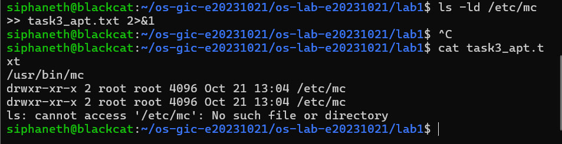
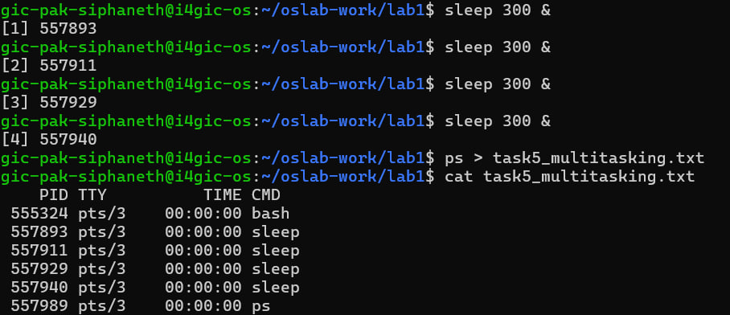
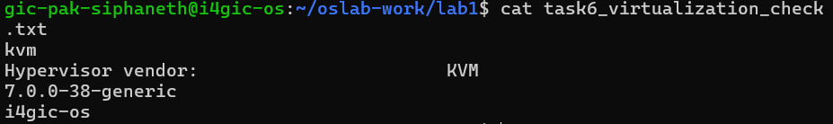

# Lab 1 — Pak Siphaneth (e20231021)

## Task 1 — Kernel and distribution
(Kernel version: ... Ubuntu version: ... Explain the difference in 1–2 sentences.)
7.0.0-38-generic	The kernel version: Linux kernel 7.0.0, build 38
Ubuntu 26.04.1 LTS	The distribution version: Ubuntu 26.04.1. LTS means Long Term Support
resolute	Ubuntu’s code name for version 26.04
i4gic-os	The server’s name (host name)
x86_64	The processor type (64-bit Intel/AMD)
## Task 3 — Remove and purge
(What did `ls -ld /etc/mc` show after remove? After purge? What is the difference?)
remove uninstalls the program but keeps its settings in /etc/mc.
purge uninstalls the program and deletes its settings.

## Task 4 — Program and process
(What did you see before, during and after `sleep 30`? Where was the program, where was the process?)
Before: which sleep showed a file, probably /usr/bin/sleep. That’s the program, a file on the disk.
During: ps showed sleep with a PID. That’s the process, the program while it runs in memory.
After 30 seconds: sleep was gone from ps, because the process ended. But which sleep still showed the same file, because the program stays on the disk.

So a program is a file that stays, and a process is a running copy that starts and ends. Your two sleep lines show something extra: one program can have several processes at the same time, each with its own PID.
## Task 5 — Multitasking
(How many sleep processes did you see at the same time?)
4 processes from one program: all four are sleep, but each has its own PID, so the system treats them as separate processes.
They exist at the same time, which shows the OS running several processes together (multitasking).
TIME is 00:00:00 for all of them, because sleep just waits and uses no processor. So this shows that processes can exist together, not how the processor is shared.
Small extra: bash and ps are processes too. Even a simple command like ps becomes a process while it runs.

## Task 6 — Virtual machine
the course server is not real hardware. It’s a virtual machine running on KVM, a hypervisor built into Linux. Two different commands gave the same answer, which makes the result reliable. If it were real hardware, the first line would say none

## Prediction
(For each guess: confirmed or corrected, and why.)
